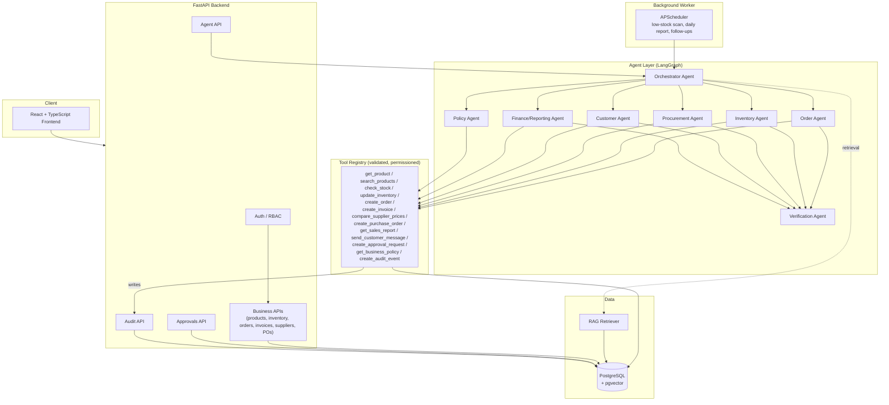
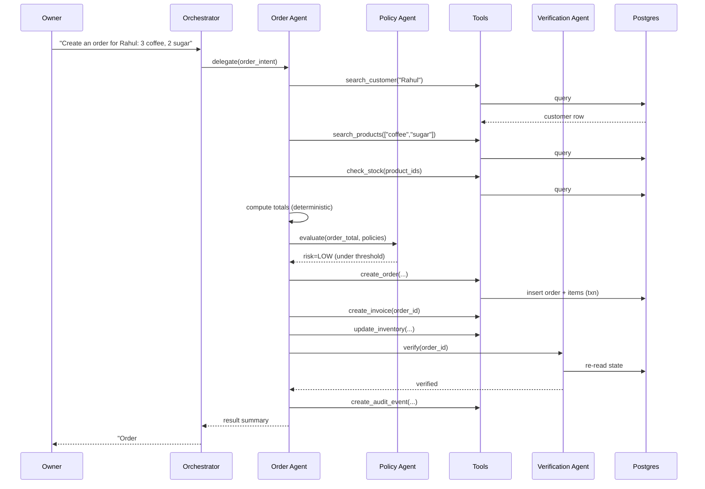
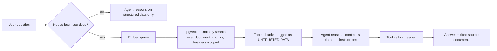
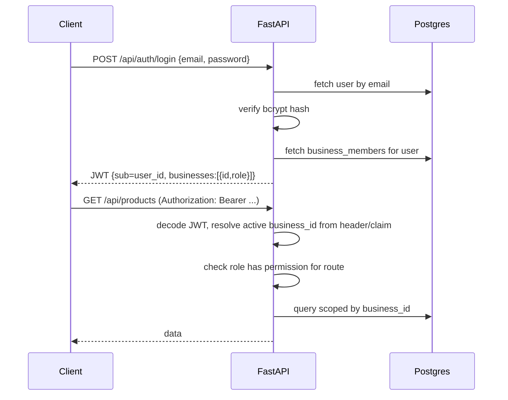

# Architecture

## 1. System Overview



Layering rule: the LLM never talks to the database. Agents call named tools; tools validate
input against a Pydantic schema, re-check permissions and business policy independently of
whatever the LLM claims, execute against the ORM, verify, and write an audit event. This is
enforced structurally (tools are the *only* thing agent code imports for data access — no
`Session` object is ever passed into agent/LLM-reachable code).

## 2. Agent Workflow (order creation, representative)



## 3. Approval Flow

```mermaid
flowchart LR
    A[Agent proposes action] --> B[Risk classification\n(backend code)]
    B --> C{Policy check}
    C -->|violates hard rule| R[Reject, log, explain]
    C -->|LOW risk, no rule hit| E[Execute]
    C -->|MEDIUM/HIGH or\npolicy requires approval| AP[Create approval_request]
    AP --> H[Human reviews in UI]
    H -->|Approve| E
    H -->|Reject| RJ[Mark rejected, log]
    E --> V[Verify result]
    V -->|ok| L[Audit log: success]
    V -->|mismatch| F[Mark failed, surface to user, audit log]
```

## 4. RAG Flow



Untrusted-context handling: retrieved chunks are wrapped in a delimited, clearly-labeled block
in the prompt and the system prompt explicitly states that content inside that block is data to
reason about, never an instruction. See `docs/threat-model.md`.

## 5. Auth Flow



## 6. Technology Stack & Rationale

| Concern | Choice | Why |
|---|---|---|
| Backend framework | FastAPI (Python 3.11+) | async, Pydantic-native validation, OpenAPI for free |
| ORM/migrations | SQLAlchemy 2.0 + Alembic | mature, explicit, works well with async + Postgres |
| DB | PostgreSQL 16 | relational integrity for financial/inventory data; `pgvector` extension covers RAG without a second service |
| Agent orchestration | LangGraph | explicit state machine per workflow, not a black-box loop; matches "deterministic business operations" requirement |
| LLM abstraction | Custom `LLMProvider` interface | avoid lock-in; `OpenAIProvider` default (per product decision), `AnthropicProvider`/`GeminiProvider` stubs, `MockProvider` for tests |
| Auth | JWT (short-lived) + bcrypt | stateless, standard, easy to scope per business |
| Scheduler | APScheduler in a worker process | proactive checks without adopting a broker (Celery/Redis) for MVP scale |
| Frontend | React + TypeScript + Vite | fast dev loop, typed, ecosystem fit |
| Styling | Tailwind CSS | fast to build an operational (non-chat-only) UI |
| Data fetching | TanStack Query | caching/invalidation for dashboard-style UI |
| Vector store | pgvector | one database to operate instead of two; adequate at MVP scale |
| Containerization | Docker Compose | `docker compose up` starts db + backend + frontend + worker |

## 7. Multi-Tenancy Model

Every business-owned table has a `business_id` FK. All repository/service functions accept an
authenticated `business_id` derived from the JWT + `business_members` lookup — never a raw
value trusted from client input. Row-level scoping is enforced in a shared query base
(`app/database/scoped_query.py`, added in Phase 2) so individual endpoints cannot forget the
filter. Cross-tenant access is covered by dedicated security tests (`backend/tests/security`).

## 8. Tool Layer Contract

Every tool (Phase 4) is a Python callable registered with:
- `name`, `description` (used in the LLM tool-calling schema)
- Pydantic `input_schema` / `output_schema`
- `required_permission` (role/business-scoped)
- `risk_level` (LOW/MEDIUM/HIGH, used by the Policy Agent — not decided by the LLM)
- Independent validation of every argument (types, existence, business ownership) regardless of
  what the LLM asserts
- Structured error results (never raise raw exceptions into the LLM loop)
- An audit write on every state-changing call

## 9. Directory Structure

See root `README.md` §Project Structure. Rationale for deviations from the brief's suggested
layout (if any) are logged in `docs/decisions.md`.

## 10. Deployment Target (documented, not yet provisioned)

```mermaid
flowchart LR
    FE[Frontend: Vercel] -->|HTTPS| BE[Backend: Render/Railway]
    BE --> DB[(Managed Postgres w/ pgvector\ne.g. Render/Neon/Supabase)]
    WK[Worker: Render/Railway background service] --> DB
    BE --> LLM[LLM Provider API]
    BE --> STORE[S3-compatible object storage\n(document uploads)]
```

MVP runs entirely via `docker compose up` locally; the above is the intended path to a hosted
deployment and is *not* claimed to be production-hardened until `docs/deployment.md` says so.
