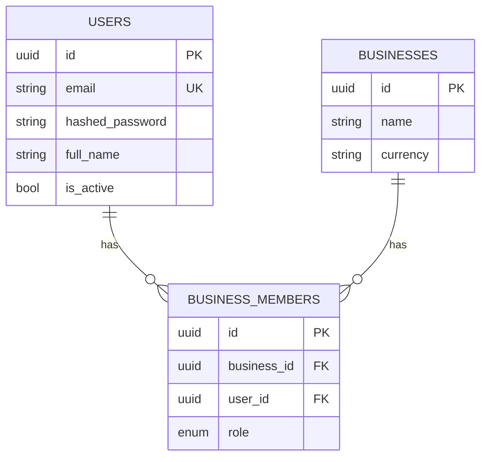

# Database

PostgreSQL 16 + pgvector (extension enabled but unused until Phase 7 RAG). Managed via
SQLAlchemy 2.0 (async, `asyncpg` driver) + Alembic migrations. Schema source of truth is
`backend/app/models/`; migrations live in `backend/alembic/versions/`.

## Conventions

- Every table has a UUID primary key (`UUIDPrimaryKeyMixin`, `uuid4`, generated app-side) —
  chosen over serial ints so business/resource ids aren't guessable/enumerable across tenants.
- Every table has `created_at`/`updated_at` (`TimestampMixin`, timezone-aware, UTC).
- Soft delete (`deleted_at`) is added only where historical references exist (products,
  customers, suppliers — from Phase 3 onward); auth/business tables use hard delete since
  nothing references a deleted user/business/membership historically.

## Tables implemented so far

### `users`
`id, email (unique, indexed), hashed_password, full_name, is_active, created_at, updated_at`

### `businesses`
`id, name, currency (default "INR"), created_at, updated_at`

### `business_members`
`id, business_id (FK → businesses, cascade delete), user_id (FK → users, cascade delete), role
(enum: OWNER/ADMIN/EMPLOYEE), created_at, updated_at`
Unique constraint on `(business_id, user_id)` — one role per user per business.



## Planned tables (not yet implemented)

`products, inventory, customers, orders, order_items, invoices, invoice_items, suppliers,
supplier_products, purchase_orders, purchase_order_items, payments, business_policies,
documents, document_chunks (pgvector), agent_sessions, agent_tasks, agent_actions,
approval_requests, audit_logs, notifications` — added domain by domain in Phases 3–7, each
documented here when it ships.

## Migration workflow

```bash
cd backend
alembic revision --autogenerate -m "description"
# review the generated file — autogenerate is a starting point, not ground truth
alembic upgrade head
```

The initial migration (`ce7433006869_initial_schema_users_businesses_.py`) creates `users`,
`businesses`, `business_members` and was generated + applied against a real Postgres instance,
then reviewed by hand before being committed.
