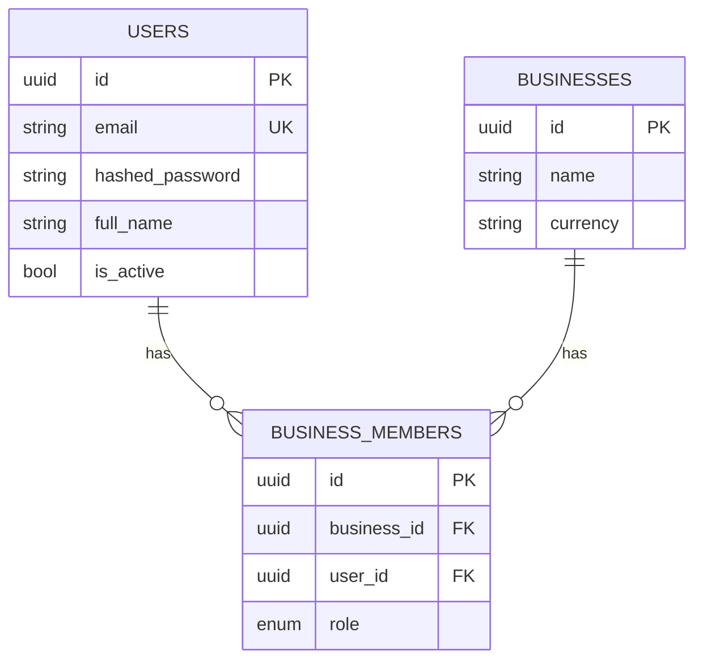
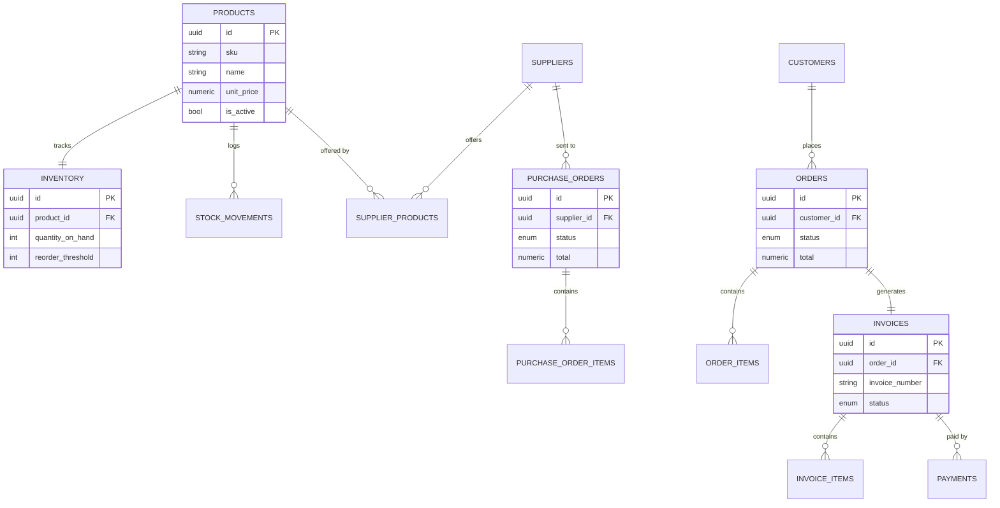

# Database

PostgreSQL 16 + pgvector (extension enabled but unused until Phase 7 RAG). Managed via
SQLAlchemy 2.0 (async, `asyncpg` driver) + Alembic migrations. Schema source of truth is
`backend/app/models/`; migrations live in `backend/alembic/versions/`.

## Conventions

- Every table has a UUID primary key (`UUIDPrimaryKeyMixin`, `uuid4`, generated app-side) —
  chosen over serial ints so business/resource ids aren't guessable/enumerable across tenants.
- Every table has `created_at`/`updated_at` (`TimestampMixin`, timezone-aware, UTC).
- Soft delete (`deleted_at`) is added only where historical references exist (products,
  customers, suppliers — from Phase 3 onward); auth/business tables use hard delete since
  nothing references a deleted user/business/membership historically.

## Tables implemented so far

### `users`
`id, email (unique, indexed), hashed_password, full_name, is_active, created_at, updated_at`

### `businesses`
`id, name, currency (default "INR"), created_at, updated_at`

### `business_members`
`id, business_id (FK → businesses, cascade delete), user_id (FK → users, cascade delete), role
(enum: OWNER/ADMIN/EMPLOYEE), created_at, updated_at`
Unique constraint on `(business_id, user_id)` — one role per user per business.



## Phase 3 tables (Core Business)

All of these carry `business_id` (FK → businesses, cascade). Money columns are
`Numeric(12, 2)`. See `docs/decisions.md` ADR-014 for why `tax_amount` exists but is always 0.

- **`products`** — `sku` (unique per business), `name`, `description?`, `unit`, `unit_price`,
  `cost_price?`, `is_active`, `deleted_at` (soft delete).
- **`inventory`** — one row per `(business_id, product_id)` (unique constraint), created
  automatically with every product. `quantity_on_hand`, `reorder_threshold`,
  `reorder_quantity`.
- **`stock_movements`** — immutable log of every inventory change (no `updated_at` — an audit
  row is never edited). `product_id`, `change_quantity` (±), `reason` (enum: SALE,
  ORDER_CANCELLED, PURCHASE_RECEIPT, ADJUSTMENT), `reference_type`/`reference_id`, `note?`,
  `created_by_user_id`. This is what makes FR-6 ("stock changes tracked, not just a mutable
  counter") true — `inventory.quantity_on_hand` is never written without a corresponding row
  here.
- **`customers`** — `name`, `email?`, `phone?`, `address?`, `deleted_at`.
- **`suppliers`** — `name`, `email?`, `phone?`, `is_active`, `deleted_at`.
- **`supplier_products`** — one row per `(supplier_id, product_id)` (unique constraint):
  `price`, `lead_time_days`. Drives `/api/suppliers/compare`.
- **`orders`** — `customer_id`, `status` (enum: CONFIRMED, CANCELLED), `subtotal`,
  `tax_amount`, `total`, `currency` (snapshotted from the business at order time),
  `created_by_user_id`.
- **`order_items`** — `order_id`, `product_id`, `quantity`, `unit_price` (snapshotted from the
  product — historical orders stay accurate if the price later changes), `line_total`.
- **`invoices`** — `order_id` (unique — one invoice per order in MVP, see ADR-014),
  `invoice_number` (`INV-{sequence:06d}`), `status` (enum: ISSUED, PAID, VOID), `subtotal`,
  `tax_amount`, `total`, `issued_at`.
- **`invoice_items`** — mirrors `order_items` 1:1 today; kept as its own table so partial
  invoicing is a data change later, not a schema change.
- **`payments`** — `invoice_id`, `amount`, `method` (enum: CASH/CARD/UPI/BANK_TRANSFER/OTHER),
  `paid_at`, `recorded_by_user_id`.
- **`purchase_orders`** — `supplier_id`, `status` (enum: DRAFT, SENT, COMPLETED, CANCELLED —
  see ADR-015 for why `PENDING_APPROVAL`/`APPROVED` aren't here yet), `subtotal`, `total`,
  `created_by_user_id`, `sent_at?`, `completed_at?`.
- **`purchase_order_items`** — `purchase_order_id`, `product_id`, `quantity`, `unit_cost`,
  `line_total`.



## Phase 4 tables (Agent observability — FR-14/FR-15)

One `agent_sessions` row per chat request; one `agent_tasks` row per workflow run; one
`agent_actions` row per tool call, written **structurally by the tool registry** — agent code
cannot call a tool without recording, and cannot record without calling a tool (ADR-003).

- **`agent_sessions`** — `business_id`, `user_id`, `intent` (enum: CREATE_ORDER,
  CHECK_INVENTORY, LOW_STOCK, COMPARE_SUPPLIERS, CREATE_PURCHASE_ORDER, SEARCH_PRODUCTS,
  SEARCH_CUSTOMERS, SALES_REPORT, UNKNOWN), `status` (RUNNING, COMPLETED, FAILED,
  NEEDS_CLARIFICATION), `user_message`, `reply?`, `completed_at?`.
- **`agent_tasks`** — `session_id`, `agent_name` (order/inventory/procurement/customer/finance),
  `status` (RUNNING, COMPLETED, FAILED), `started_at`, `completed_at?`.
- **`agent_actions`** — `task_id`, `business_id`, `tool_name`, `status` (SUCCESS, FAILED,
  REJECTED), `risk_level` (LOW/MEDIUM — deterministic, ADR-004), `input_summary` (JSONB,
  compacted), `result_summary` (JSONB, compacted), `created_by_user_id`, `created_at`. No
  `updated_at` — an audit row is never edited (same rule as `stock_movements`).

## Planned tables (not yet implemented)

`business_policies, documents, document_chunks (pgvector), approval_requests, audit_logs,
notifications` — added domain by domain in Phases 5–7, each documented here when it ships.

## Migration workflow

```bash
cd backend
alembic revision --autogenerate -m "description"
# review the generated file — autogenerate is a starting point, not ground truth
alembic upgrade head
```

Migrations so far:
- `ce7433006869` — initial schema: `users`, `businesses`, `business_members`.
- `54c4b61cdb48` — Phase 3: `products`, `inventory`, `stock_movements`, `customers`,
  `suppliers`, `supplier_products`, `orders`, `order_items`, `invoices`, `invoice_items`,
  `payments`, `purchase_orders`, `purchase_order_items`.
- `f2c2e0ac428e` — Phase 4: `agent_sessions`, `agent_tasks`, `agent_actions`.

Each was generated via `alembic revision --autogenerate` against a real Postgres instance,
reviewed by hand, and applied before being committed. To migrate the dedicated test database
(`ai_employee_test`), alembic reads `DATABASE_URL`, so run it with that env var pointed at the
test DB (not `TEST_DATABASE_URL`, which only the pytest fixtures use).

**Local-dev note:** on this Windows dev machine, running Alembic/asyncpg directly against the
Docker-mapped Postgres port from the host was unreliable (see `docs/troubleshooting.md`); the
Phase 3 migration was generated and applied via `docker compose exec backend alembic ...`
instead, which talks to `db` over the internal Docker network.
