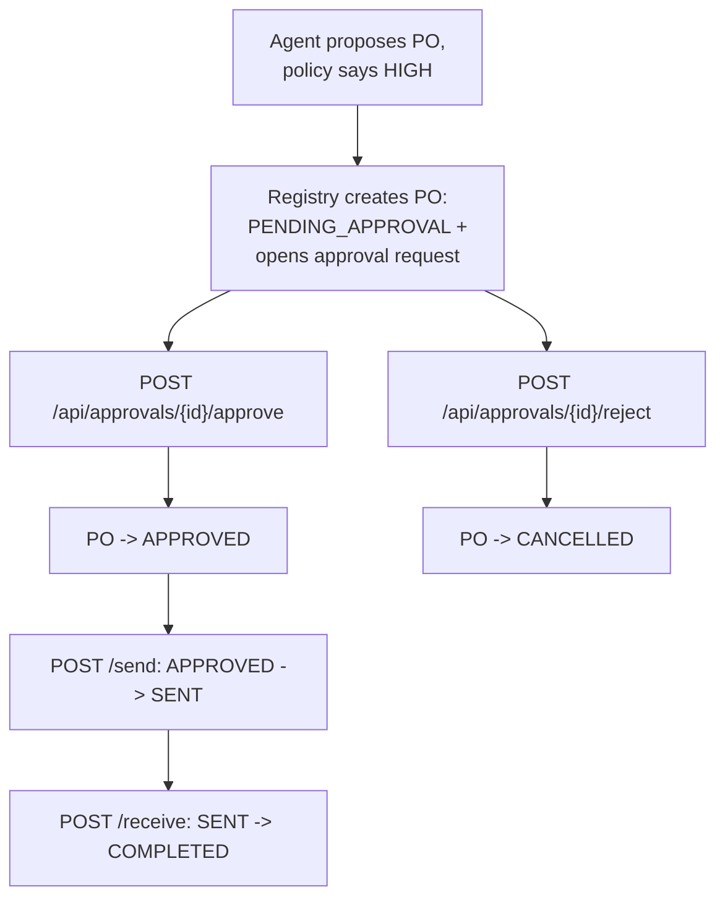

# Workflows

These reflect the actual implementation (Phase 3 — plain API-triggered workflows; Phase 4 adds
the agent/LLM layer in front of the same endpoints, so these diagrams don't change shape, only
gain an "agent decided to call this" step in front).

## Order Processing (`POST /api/orders`, `backend/app/api/orders.py`)

```mermaid
flowchart TD
    A[Request: customer_id + items] --> B{Customer exists\nin this business?}
    B -->|no| E1[404]
    B -->|yes| C[Merge duplicate product_id lines]
    C --> D{All products exist,\nactive, in this business?}
    D -->|no| E2[404]
    D -->|yes| F{Stock sufficient\nfor every line?}
    F -->|no| E3["422 (no order created)"]
    F -->|yes| G[Compute line totals, subtotal,\ntax (=0 for MVP), total]
    G --> H[Create Order + OrderItems]
    H --> I[Decrement Inventory per line +\nwrite StockMovement(reason=SALE)]
    I --> J[Create Invoice + InvoiceItems\nnumber = INV-NNNNNN]
    J --> K[Commit transaction]
    K --> L[201: OrderRead incl. invoice_id/number]
```

All of B–K happens in one DB transaction — a partial order (created but stock not decremented,
or decremented but no invoice) is not a state this workflow can leave the database in.

### Order Cancellation (`POST /api/orders/{id}/cancel`)

```mermaid
flowchart TD
    A[Cancel request] --> B{Already CANCELLED?}
    B -->|yes| E1[409]
    B -->|no| C{Invoice already PAID?}
    C -->|yes| E2["409 (refunds not supported yet)"]
    C -->|no| D[Restore inventory per line +\nStockMovement(reason=ORDER_CANCELLED)]
    D --> E[Order -> CANCELLED, Invoice -> VOID]
    E --> F[200]
```

## Procurement (`POST /api/purchase-orders` → `/send` → `/receive`)

```mermaid
flowchart TD
    subgraph Create["POST /api/purchase-orders"]
        A[supplier_id + items] --> B{Supplier exists,\nactive?}
        B -->|no/inactive| E1[404 / 422]
        B -->|yes| C{Each product exists?}
        C -->|no| E2[404]
        C -->|yes| D{unit_cost given?}
        D -->|no| F{supplier_products\nprice on file?}
        F -->|no| E3[422]
        F -->|yes| G[Use that price]
        D -->|yes| G
        G --> H[Compute line totals + subtotal]
        H --> I[Create PurchaseOrder: DRAFT]
    end

    I --> J["POST /send: DRAFT -> SENT"]
    J --> K["POST /receive: SENT -> COMPLETED"]
    K --> L[Increment inventory per line +\nStockMovement(reason=PURCHASE_RECEIPT)]
```

Partial receipt isn't implemented — `/receive` always books the full ordered quantity of every
line (documented limitation, see `docs/database.md`).

Supplier comparison (`GET /api/suppliers/compare?product_id=`) that would typically precede
creating a purchase order is its own read-only endpoint — see `docs/api.md` — ranking active
suppliers by price then lead time via `app/services/procurement.py`, the same function Phase
4's Procurement Agent will call.

## Approval-gated purchase order (Phase 5, FR-9/FR-18)

When the Procurement Agent proposes a purchase order that the policy engine classifies **HIGH**
(a `MONEY_THRESHOLD` policy is exceeded), the tool registry does **not** execute it directly.
Instead it creates the PO in `PENDING_APPROVAL` and opens an `approval_requests` row targeting
it; the agent stops and reports that a human decision is needed. A human then resolves it via
the approvals API, which drives the PO's lifecycle:



The decision is role-gated by the business's `APPROVAL_ROLES` policy (default OWNER/ADMIN);
there is no code path for an agent to approve its own request. All REST writes and registry tool
calls additionally append to the unified `audit_logs` (FR-25).

## Not yet implemented

Low-stock-driven reordering and demand forecasting land in Phase 6. Failure-recovery flow (what
happens when a workflow fails partway) is documented once multi-step workflows that aren't
single DB transactions exist.
